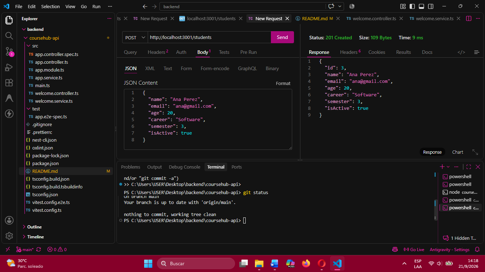
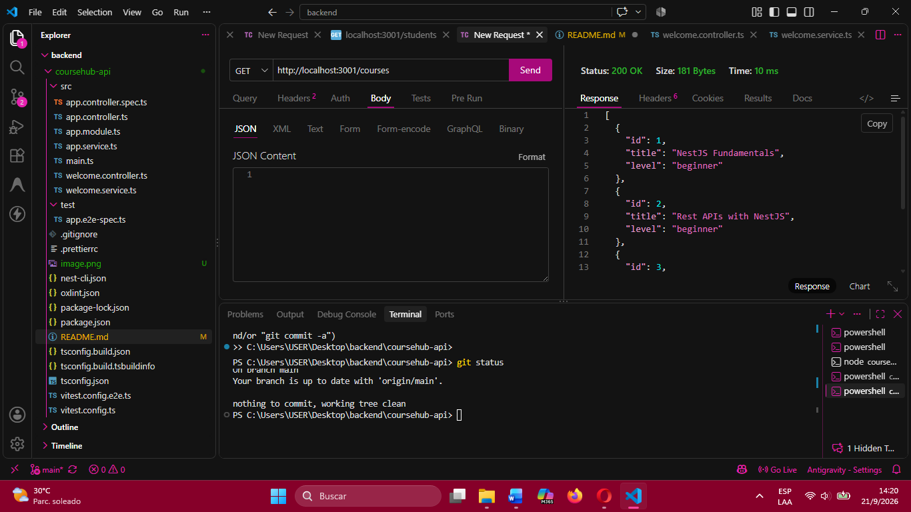
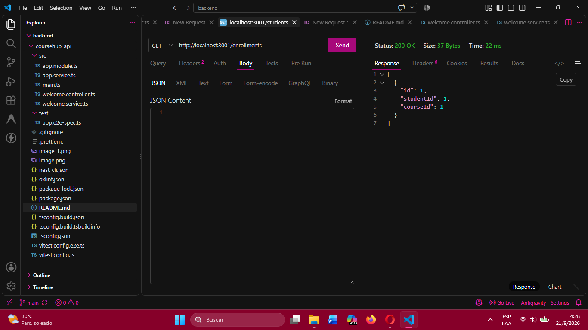
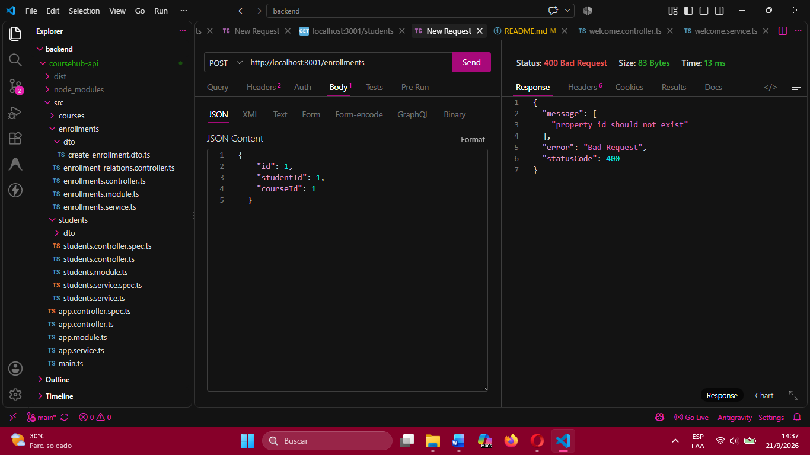
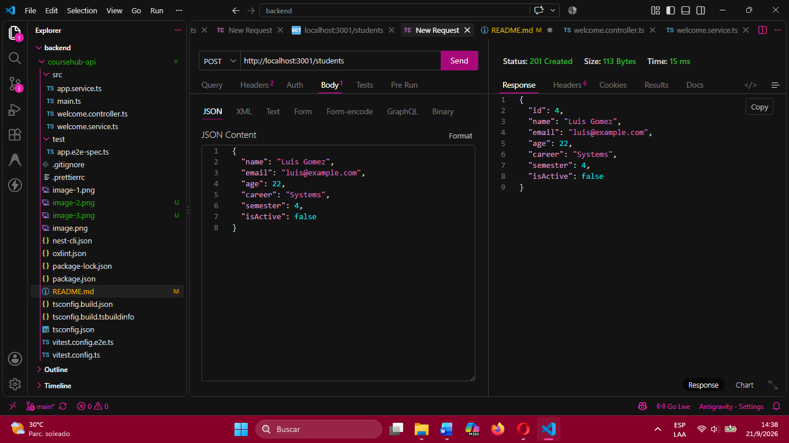
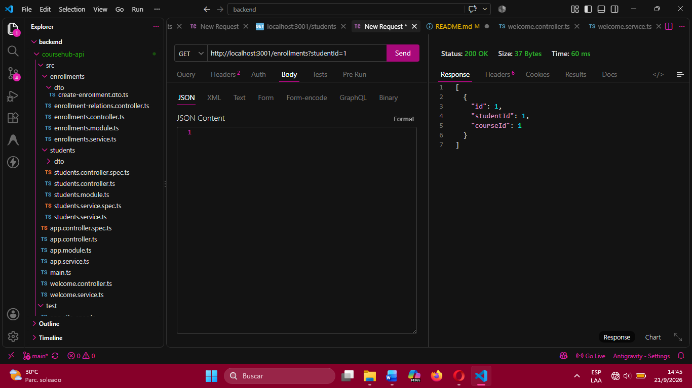
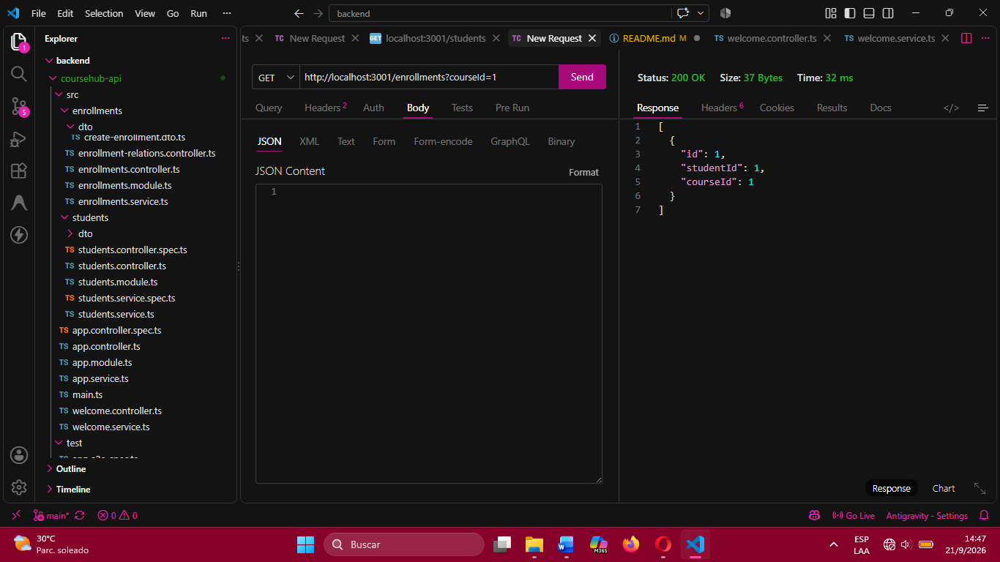
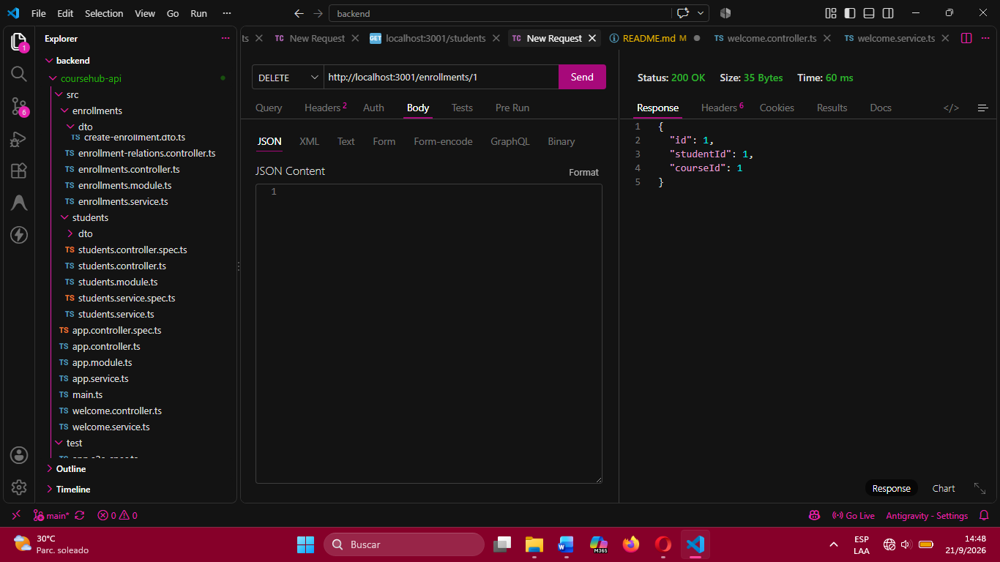
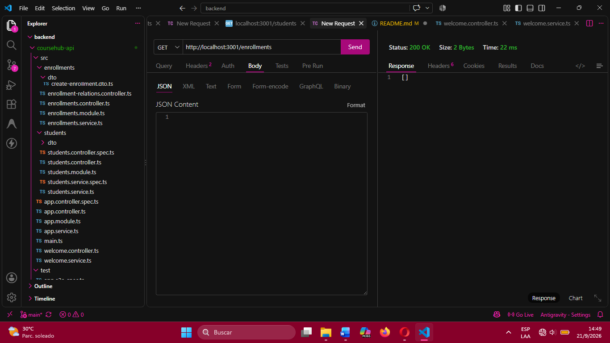

# CourseHub API

Proyecto realizado para la evaluación práctica de NestJS. La API administra cursos, estudiantes y matrículas con persistencia en PostgreSQL.


## Módulos

- **Cursos:** administra los cursos disponibles.
- **Estudiantes:** administra estudiantes y su estado activo o inactivo.
- **Matrículas:** relaciona estudiantes con cursos.
- **Usuarios:** registra usuarios almacenando únicamente un hash bcrypt de la contraseña.

Las reglas de negocio están en los servicios. Los controladores reciben los datos y delegan el procesamiento. La aplicación usa `ValidationPipe` global con `whitelist`, `forbidNonWhitelisted` y `transform`.

La conexión PostgreSQL se configura mediante variables de entorno. Para
desarrollo local se puede usar `DATABASE_SYNCHRONIZE=true`; la aplicación
fuerza `synchronize=false` cuando `NODE_ENV=production`. El archivo `.env`
local no se publica.

## Configuración y ejecución

Requisitos:

- Node.js
- PostgreSQL disponible en `localhost:5432` o en los valores configurados
- Una base de datos llamada `coursehub` (o el nombre indicado en `.env`)

Instala las dependencias:

```bash
npm install
```

Copia `.env.example` como `.env` y configura al menos estas variables:

```env
NODE_ENV=development
PORT=3001
DATABASE_HOST=localhost
DATABASE_PORT=5432
DATABASE_NAME=coursehub
DATABASE_USER=postgres
DATABASE_PASSWORD=tu_password
DATABASE_SYNCHRONIZE=true
```

Inicia la API en desarrollo:

```bash
npm run start:dev
```

En desarrollo, TypeORM crea o actualiza las tablas de las entidades
`Course`, `Student` y `Enrollment` cuando `DATABASE_SYNCHRONIZE=true`. En
producción se debe usar `DATABASE_SYNCHRONIZE=false` y gestionar los cambios
de esquema mediante migraciones antes de iniciar la aplicación.

La configuración se valida antes de inicializar la conexión. `PORT` y
`DATABASE_PORT` deben ser puertos válidos, y `DATABASE_SYNCHRONIZE` solo puede
tener los valores `true` o `false`. Si falta una variable obligatoria o tiene
un valor inválido, la API se detiene al arrancar y muestra el error de
configuración en lugar de iniciar con valores incompletos.

La política por ambiente es explícita: `development` y `test` pueden usar
`DATABASE_SYNCHRONIZE=true`, mientras que `production` exige
`DATABASE_SYNCHRONIZE=false`. El archivo
[`.env.production.example`](./.env.production.example) sirve como plantilla
para preparar la configuración de la siguiente etapa; no contiene secretos
reales.

### Verificación de los dos escenarios

Para verificar desarrollo sin modificar datos, usa un `.env` local con
`NODE_ENV=development` y `DATABASE_SYNCHRONIZE=true`, y ejecuta:

```bash
npm run build
npm run start
```

La API debe iniciar y responder en el puerto configurado.

Para verificar la política de producción sin desplegar, después de ejecutar
`npm run build`, abre una terminal PowerShell separada y usa:

```powershell
$env:NODE_ENV="production"
$env:DATABASE_SYNCHRONIZE="true"
node dist/main
```

La aplicación debe detenerse antes de conectarse y mostrar:

```text
DATABASE_SYNCHRONIZE must be false when NODE_ENV is production
```

Después de la prueba, cierra esa terminal o elimina las variables temporales
con `Remove-Item Env:NODE_ENV, Env:DATABASE_SYNCHRONIZE`.


## Endpoints

| Método | Endpoint | Descripción |
| --- | --- | --- |
| GET | `/courses` | Lista cursos con filtro, paginación y ordenamiento. |
| GET | `/courses/:id` | Consulta un curso. |
| POST | `/courses` | Crea un curso. |
| PATCH | `/courses/:id` | Actualiza un curso. |
| DELETE | `/courses/:id` | Elimina un curso. |
| POST | `/users/register` | Registra un usuario sin almacenar su contraseña en texto plano. Devuelve `id`, `name`, `email` y `createdAt`. |
| GET | `/students` | Lista estudiantes. Acepta `career`, `semester` e `isActive` como filtros. |
| GET | `/students/:id` | Consulta un estudiante. |
| POST | `/students` | Crea un estudiante. |
| PATCH | `/students/:id` | Actualiza un estudiante. |
| DELETE | `/students/:id` | Elimina un estudiante. |
| POST | `/enrollments` | Registra una matrícula. |
| GET | `/enrollments` | Busca y lista matrículas con relaciones, filtros, paginación y ordenamiento. |
| GET | `/enrollments/:id` | Consulta una matrícula. |
| DELETE | `/enrollments/:id` | Cancela una matrícula. |
| GET | `/students/:studentId/enrollments` | Matrículas de un estudiante. |
| GET | `/courses/:courseId/enrollments` | Matrículas de un curso. |

### Consulta paginada de cursos

`GET /courses` acepta los siguientes parámetros opcionales:

| Parámetro | Valores | Predeterminado |
| --- | --- | --- |
| `level` | `beginner`, `intermediate` o `advanced` | Sin filtro |
| `page` | Entero mayor o igual a `1` | `1` |
| `limit` | Entero entre `1` y `100` | `10` |
| `sort` | `id`, `title` o `level` | `id` |
| `order` | `asc` o `desc` | `asc` |

Ejemplo:

```text
GET /courses?level=intermediate&page=1&limit=10&sort=title&order=asc
```

La respuesta mantiene una forma consistente:

```json
{
  "data": [
    {
      "id": 1,
      "title": "Bases de Datos",
      "level": "intermediate"
    }
  ],
  "meta": {
    "page": 1,
    "limit": 10,
    "total": 1,
    "totalPages": 1
  }
}
```

Los parámetros inválidos producen `400 Bad Request`; los valores de
`sort` y `order` se limitan a una lista permitida para evitar ordenar por
columnas no contempladas.

El correo de los estudiantes es único, si se intenta crear o actualizar un
estudiante con un correo ya registrado, la API responde `409 Conflict`.

Las respuestas de matrículas incluyen `student` y `course` con la información relacionada, además de `studentId` y `courseId`.
Los filtros `studentId` y `courseId` de `GET /enrollments` se pueden combinar.

### Búsqueda relacionada de matrículas

`GET /enrollments` usa un `QueryBuilder` con parámetros seguros y acepta:

| Parámetro | Valores | Predeterminado |
| --- | --- | --- |
| `q` | Texto buscado en nombre/email del estudiante o título del curso | Sin búsqueda |
| `studentId` | ID entero del estudiante | Sin filtro |
| `courseId` | ID entero del curso | Sin filtro |
| `page` | Entero mayor o igual a `1` | `1` |
| `limit` | Entero entre `1` y `100` | `10` |
| `sort` | `id`, `studentName` o `courseTitle` | `id` |
| `order` | `asc` o `desc` | `asc` |

Los filtros se pueden combinar. Por ejemplo:

```text
GET /enrollments?q=ana&studentId=1&page=1&limit=10&sort=courseTitle&order=asc
```

La respuesta incluye los datos relacionados y metadatos de paginación:

```json
{
  "data": [],
  "meta": {
    "page": 1,
    "limit": 10,
    "total": 0,
    "totalPages": 0
  }
}
```

### Reglas de creación de matrículas

Al crear una matrícula mediante `POST /enrollments`, las validaciones se
ejecutan en este orden:

| Situación | Respuesta |
| --- | --- |
| El estudiante no existe | `404 Not Found` |
| El curso no existe | `404 Not Found` |
| El estudiante está inactivo | `400 Bad Request` |
| Ya existe la pareja estudiante–curso | `409 Conflict` |

La última regla también está protegida por la restricción única compuesta de la
base de datos para evitar duplicados en solicitudes concurrentes.

## Verificación de persistencia

La persistencia se puede comprobar con el flujo siguiente:

1. Inicia PostgreSQL y la API.
2. Crea un curso con `POST /courses`.
3. Consulta el curso con `GET /courses` o `GET /courses/:id`.
4. Detén y vuelve a iniciar la API.
5. Consulta nuevamente el curso. Si sigue disponible, los datos se están
   leyendo desde PostgreSQL y no desde un arreglo en memoria.


## Evidencias

Creacion de un nuevo estudiante:


Consultar cursos:


Consultar matricula:


No acepta matriculas duplicadas:


Se registro un nuevo estudiante:


Filtrado de estudiantes:


Filtrado de matricula por curso:


Cancelar matricula:

